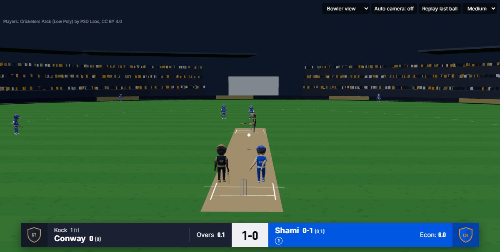
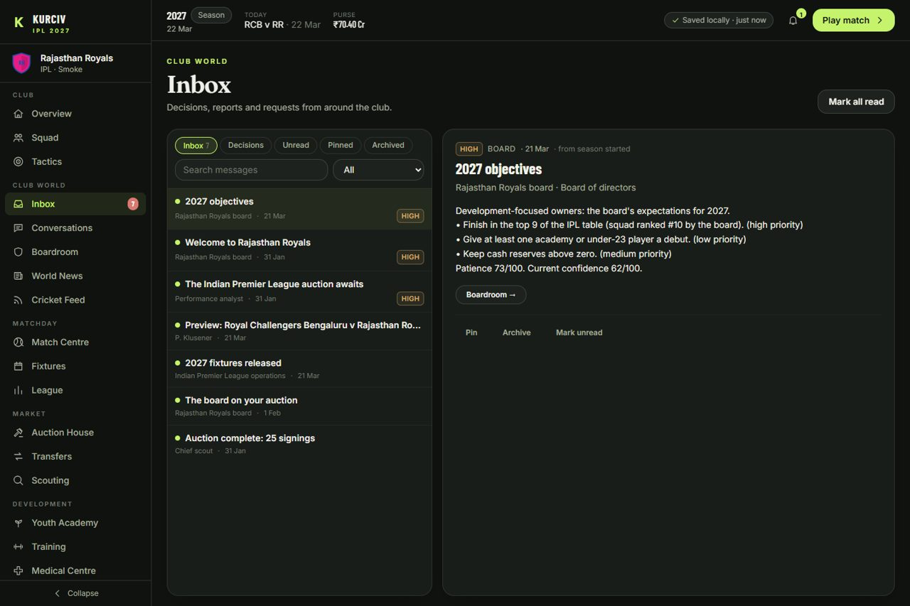
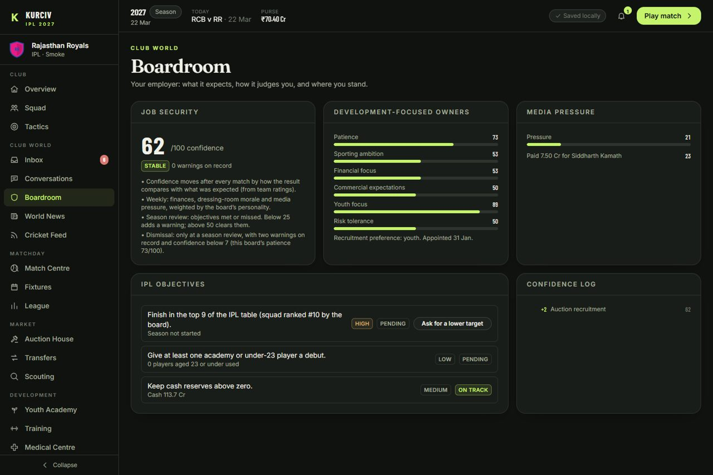
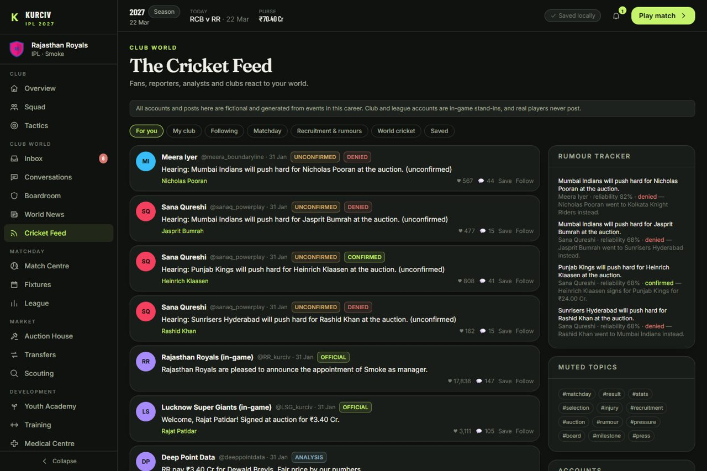

# Kurciv IPL 2027

**A T20 cricket management game that runs entirely in your browser.**

**▶ Play it now: [kurciv-ipl-2027.vercel.app](https://kurciv-ipl-2027.vercel.app/)**

You take charge of one franchise in one of 11 leagues. Bid for your squad in a live auction, pick your XI and captain, play every match ball by ball in 3D or simulate it, and manage the people: players who want answers, a board that judges you, and a cricket world that reacts to everything you do. Every other club, auction and match in the world is run by AI through the same engine.



There is nothing to install and no account to create. Careers are saved in your own browser.

---

## Features

### On the field
- **Ball-by-ball T20 engine.** Every delivery resolves line, length, shot choice, timing, ball flight, fielding and running between the wickets. Matches are seeded and fully replayable.
- **Realistic scoring.** Calibrated to about 7–8 runs an over with realistic wickets, dot balls and boundaries, guarded by an automated calibration test. See [docs/BALANCE_REPORT.md](docs/BALANCE_REPORT.md).
- **3D match view.** Cricketers in your franchise's kit, a stadium with crowd and floodlights, broadcast-style cameras, replays and DRS ball tracking. The 3D view only replays what the engine decided, so it can never change a result. A 2D scoreboard view is available, and is used automatically when 3D isn't supported.
- **You make the calls.** Toss, openers, every bowler, every incoming batter, batting approach and DRS reviews. Play continuously, ball by ball or over by over, or simulate the rest instantly.
- **Pre-match selection.** Choose your XI and batting order before each match. AI clubs select for the pitch and rest tired players.

### The club
- **Live auction cascade.** Leagues auction in order of reputation. AI clubs value players by what they add to the squad, plan their purse and explain their big buys.
- **Captain and vice-captain**, chosen each season.
- **Squad management:** fatigue, injuries, form, morale, training, youth academy, finances and retentions.

### The world
- **11 leagues and 73 clubs**, plus a 50-club World Club Championship that moves league reputations.
- **Orange and Purple Cap** races for every league, with cap holders marked in matches.
- **Player database** of 10,000 players, built from licensed Cricsheet data.

### Club World
- **Inbox:** decisions with deadlines from the board, staff, media and players.
- **Player conversations:** players raise concerns about selection, role, workload, form or their future. Your replies change trust and morale, and promises are tracked and judged on what actually happens.
- **Boardroom:** objectives, confidence and a published job-security rule.
- **World News and the Cricket Feed:** a fictional social feed reacting to real in-game events, with rumours that the auction later confirms or denies.

| Inbox | Boardroom | Cricket Feed |
| --- | --- | --- |
|  |  |  |

> **Simulation only.** There is no wagering, and results are not predictions of real cricket. Real players appear by name. Their ratings are game estimates, while their real-world records come from Cricsheet. Feed accounts and posts are fictional, and real players never "post". See [docs/DATA_SOURCES.md](docs/DATA_SOURCES.md).

---

## Run it locally

Requires **Node.js 22.13 or newer**.

```bash
npm install
npm run dev        # http://localhost:5173
```

Production build:

```bash
npm run build      # outputs apps/web/dist (a static site)
npm run preview    # serves the build locally
```

| Command | What it does |
| --- | --- |
| `npm run dev` | Vite dev server |
| `npm run build` | Production build of the web app |
| `npm test` | Unit and integration tests (Vitest), including engine calibration |
| `npm run e2e` | Browser tests (Playwright, Edge channel) |
| `npm run typecheck` | Strict TypeScript across every package and the web app |
| `npm run lab -- 2000` | Plays N seeded matches and prints a balance report |
| `npm run world-report -- <seed>` | Plays a whole world season and prints auctions, tables and reputation changes |
| `npm run ingest -- --download` | Rebuilds the player database from Cricsheet (downloads about 150 MB to `data/cache`) |
| `npm run validate-data` | Validates the curated player seed |

## Deployment

The live site is hosted on Vercel as a static build: <https://kurciv-ipl-2027.vercel.app/>. See [docs/DEPLOYMENT.md](docs/DEPLOYMENT.md) for how to deploy your own copy.

## How it's built

TypeScript monorepo (npm workspaces): React 18 + Vite + Tailwind for the UI, three.js for the 3D view, and Dexie (IndexedDB) for saves. The whole game engine runs in a Web Worker, so the interface stays responsive while seasons simulate.

```
apps/web/              React client, 3D match view (pages/match/three), engine Web Worker
packages/domain/       Entity types, ratings, registration rules, Club World types
packages/config/       Leagues, clubs, venues, engine constants (SIM), world config
packages/simulation/   Seeded RNG, field geometry, shot model, ball-by-ball engine, awards, win probability
packages/ai/           Captain AI, XI selection, match runner and replay
packages/world/        Career, auctions, competitions, calendar, condition, finance, WCC, seasons,
                       captaincy and cap races, Club World (event bus, inbox, conversations, board, media)
packages/app-core/     Storage-agnostic backend (route table), views, match reports, IndexedDB adapter
packages/data-ingestion/  Curated players, the 10,000-player database, generated players
tools/                 Simulation lab, world report, Cricsheet ingestion
e2e/                   Playwright browser tests
docs/                  Documentation (below)
```

## Documentation

- [Gameplay guide](docs/GAMEPLAY.md)
- [Architecture](docs/ARCHITECTURE.md): layers, the worker backend, determinism, the match engine, the Club World event bus, 3D presentation
- [Persistence](docs/DATABASE.md): saves, IndexedDB tables, backups and migrations
- [Configuration](docs/CONFIGURATION.md): leagues, squad rules, auctions and engine constants
- [Simulation balance report](docs/BALANCE_REPORT.md)
- [Data sources and licensing](docs/DATA_SOURCES.md)
- [Player database report](docs/PLAYER_DB_REPORT.md)
- [Deployment](docs/DEPLOYMENT.md)
- [Roadmap and known limitations](docs/ROADMAP.md)

## Credits and licences

- Player records: [Cricsheet](https://cricsheet.org/), under the Open Data Commons Attribution License (ODC-BY 1.0).
- 3D players: [Cricketers Pack (Low Poly)](https://sketchfab.com/3d-models/cricketers-pack-low-poly-a16e3f072a714e2ab382d036c42ab3a6) by P3D Labs, under CC BY 4.0. It is rigged and recoloured at load time.
- Club and league names belong to their owners. This is an unofficial fan project, not affiliated with or endorsed by any league, club or player.
